# Лабораторная работа № 2: трекинг плоского объекта по ключевым точкам

## Цель и постановка задачи

Программа получает видео, в первом кадре которого крупно показан плоский объект. На следующих кадрах она ищет этот объект, рисует четырёхугольную рамку с подписью и сохраняет обработанное видео. Если надёжных совпадений недостаточно, выводится `Object not found`; поиск продолжается на каждом следующем кадре.

В работе использованы три тестовых ролика из приложенного к заданию архива: `mona-lisa.avi`, `mona-lisa-blur.avi`, `mona-lisa-blur-extra-credit.avi`. Они, а также размеченный образец [`simple_track.avi`](test-videos/simple_track.avi), включены в репозиторий. Дополнительно проверено собственное снятое видео [`data/own-video.mp4`](data/own-video.mp4) с фотографией осеннего пейзажа. Оно обработано тем же кодом, без изменения алгоритма.

## 1. Теоретическая база

SIFT выделяет характерные точки и описывает локальные участки изображения дескрипторами, устойчивыми к изменению масштаба и повороту. Для каждого дескриптора эталона находятся два ближайших дескриптора кадра по евклидову расстоянию. Проверка отношения расстояний (`d₁ < 0,8·d₂`) отбрасывает неоднозначные соответствия.

Плоский объект при изменении положения камеры в первом приближении связывается с эталоном гомографией: `p' ~ H·p`. Матрица `H` определяется по соответствующим точкам методом RANSAC: случайные выборки позволяют отделить согласованные пары от ошибочных. Четыре угла эталона переносятся матрицей `H` в текущий кадр, поэтому рамка может менять размер и наклон. После оценки проверяются число и доля согласованных точек, выпуклость и разумная площадь четырёхугольника.

## 2. Описание системы

Исходный код — [`tracker.py`](tracker.py), зависимости — [`requirements.txt`](requirements.txt), геометрический тест — [`tests/test_tracker.py`](tests/test_tracker.py).

ТЗ разрешает Python и любые библиотеки. OpenCV здесь предоставляет операции поиска точек SIFT, сопоставления дескрипторов, оценки гомографии и чтения/записи видео; логика выбора совпадений, проверки рамки и обработки кадров находится в собственном `tracker.py`. Архитектура программы: аргументы командной строки → эталон и `PlanarTracker` → обнаружение на каждом кадре → `annotate` → выходные MP4 и CSV.

1. Первый кадр принимается как эталон. Если предмет не занимает почти весь кадр, область предмета задаётся через `--roi X Y W H`.
2. Для эталона один раз вычисляются до 2000 точек SIFT и их дескрипторы.
3. На каждом следующем кадре вычисляются точки и дескрипторы SIFT; сопоставление выполняется `BFMatcher` с нормой L2 и проверкой отношения 0,8.
4. Гомография оценивается `findHomography(..., RANSAC, 4.0)`. Для принятия результата нужны не менее восьми согласованных пар и доля согласованных пар не менее 0,3.
5. Проверяется выпуклая рамка с допустимой площадью и длинами сторон. Принятая рамка рисуется зелёным, иначе сообщается о потере объекта. В следующем кадре поиск начинается заново, поэтому объект может быть найден после возвращения.
6. На выходе создаются MP4 с разметкой и CSV со статусом, числом совпадений, числом согласованных точек и координатами углов для каждого кадра.

**Как выглядят совпадения точек.** Слева — первый кадр, справа — кадр 50. Цветные линии соединяют 20 согласованных точек одного изображения. Это иллюстрация промежуточного расчёта; в итоговом видео рисуется только рамка с подписью.

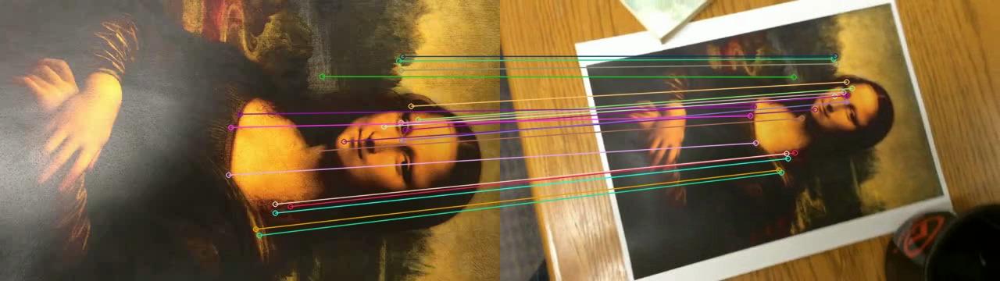

### Установка и запуск

Нужен Python 3.9 или новее. В папке проекта:

```bash
python3 -m venv .venv
source .venv/bin/activate
python -m pip install -r requirements.txt
python tracker.py test-videos/mona-lisa.avi --label "Mona Lisa"
```

Для Windows вместо `source .venv/bin/activate` используйте `.venv\Scripts\activate` в `cmd` или `.venv\Scripts\Activate.ps1` в PowerShell. Выход по умолчанию: `results/<имя>-tracked.mp4` и `results/<имя>-stats.csv`. Подпись в видеокадре лучше задавать латиницей: `cv2.putText` не выводит кириллицу штатным шрифтом.

Остальные два теста:

```bash
python tracker.py test-videos/mona-lisa-blur.avi --label "Mona Lisa"
python tracker.py test-videos/mona-lisa-blur-extra-credit.avi --label "Mona Lisa"
python -m unittest discover -s tests -v
```

Собственное видео из репозитория обрабатывается командой:

```bash
python tracker.py data/own-video.mp4 --label "Autumn landscape"
```

Первый кадр показывает крупный текстурный рисунок; далее фотография удаляется и поворачивается. Для другого видео с фоном вокруг предмета на первом кадре можно указать прямоугольную область предмета в пикселях, например:

```bash
python tracker.py my-video.mp4 --roi 100 50 400 250 --label "My object"
```

## 3. Результаты и тестирование

Тест выполнен на всех кадрах каждого ролика. Число «с рамкой» показывает, сколько кадров алгоритм **принял** как содержащие объект; это не точность распознавания, потому что для роликов нет покадровой эталонной разметки.

| Входное видео | Размер кадра | Всего кадров | С рамкой | Доля кадров с рамкой | Обработанное видео |
|---|---:|---:|---:|---:|---|
| [`mona-lisa.avi`](test-videos/mona-lisa.avi) | 640×360 | 558 | 303 | 54,3% | [MP4](results/mona-lisa-tracked.mp4) |
| [`mona-lisa-blur.avi`](test-videos/mona-lisa-blur.avi) | 640×360 | 558 | 284 | 50,9% | [MP4](results/mona-lisa-blur-tracked.mp4) |
| [`mona-lisa-blur-extra-credit.avi`](test-videos/mona-lisa-blur-extra-credit.avi) | 640×360 | 558 | 272 | 48,7% | [MP4](results/mona-lisa-blur-extra-credit-tracked.mp4) |
| [Собственное видео](data/own-video.mp4) | 720×1280 | 807 | 755 | 93,6% | [MP4](results/own-video-tracked.mp4) |

### Наглядные кадры тестового видео

| Найден — кадр 139 | Не найден — кадр 279 | Снова найден — кадр 418 |
|:---:|:---:|:---:|
| 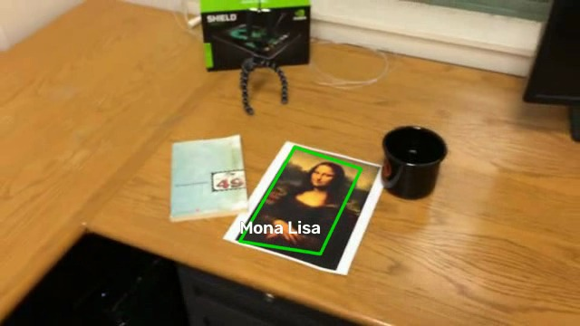 | 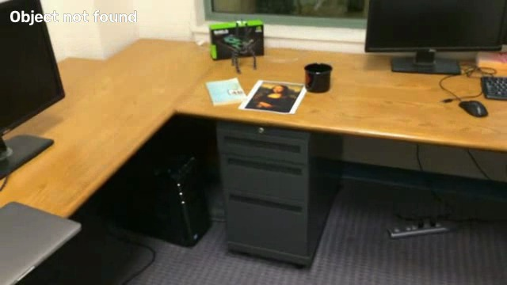 | 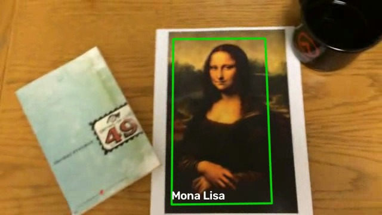 |
| Рамка следует за уменьшенным и повёрнутым рисунком. | Картина всё ещё видна на столе, но слишком мала для надёжных совпадений: это пропуск алгоритма. | Когда картина стала крупнее, программа нашла её заново по первому кадру. |

Сравнение с приложенным видеообразцом на кадре 418: зелёная рамка вокруг рисунка имеет сходное положение. Образец уже содержит свою разметку; он не является результатом нашей программы.

| Наш результат | Приложенный образец |
|:---:|:---:|
|  | 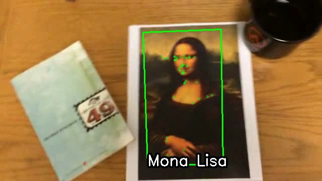 |

**Влияние сильного размытия.** На кадре 557 обычного ролика рамка есть, а в варианте `mona-lisa-blur-extra-credit.avi` при том же положении картины она отсутствует. Число устойчивых совпадений при размытии падает; программа предпочитает показать потерю объекта, а не рисовать недостоверную рамку.

| Обычное видео | Сильное размытие |
|:---:|:---:|
| 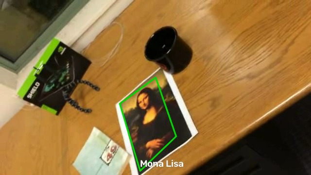 | 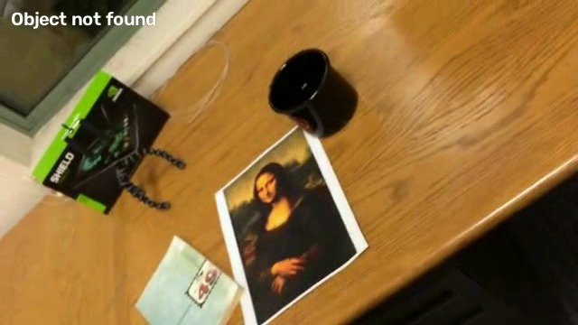 |

[Сводная галерея пяти кадров каждого тестового ролика](results/preview.jpg). Исходные и обработанные видео, а также покадровые CSV сохранены в репозитории.

На собственном ролике рамка следует за фотографией при удалении, наклоне и возвращении к камере. Из 807 кадров цель принята на 755; большинство пропусков находится в районе кадров 290–346, когда фотография мала. Рамка охватывает область рисунка, но находится внутри физических краёв отпечатка: в первом крупном кадре бумажные поля не видны, поэтому их координаты нельзя перенести гомографией. Обработанное видео [`results/own-video-tracked.mp4`](results/own-video-tracked.mp4) и покадровые данные [`results/own-video-stats.csv`](results/own-video-stats.csv) включены в репозиторий.

| Первый кадр — эталон | Кадр 150 — удаление |
|:---:|:---:|
| 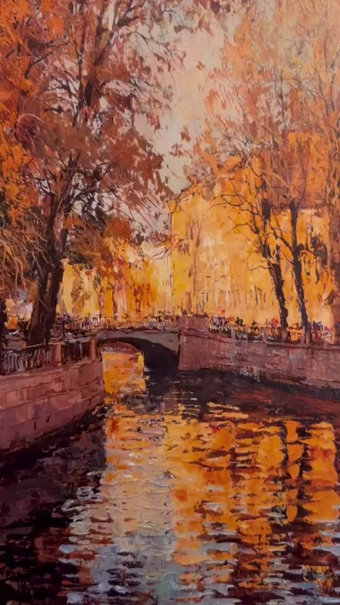 | 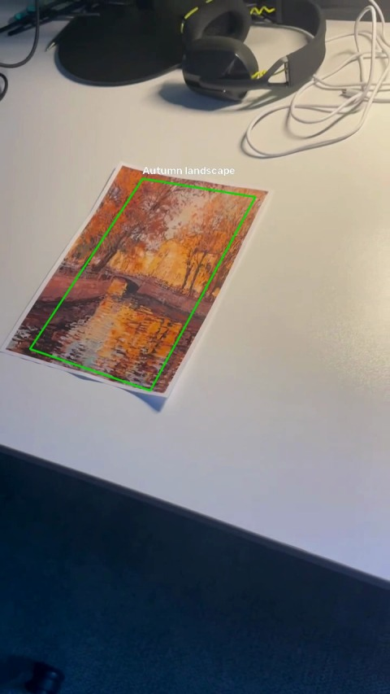 |
| Кадр 300 — объект далеко | Кадр 600 — поворот и приближение |
| 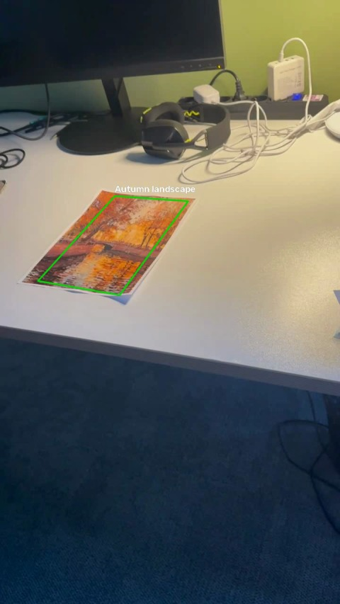 | 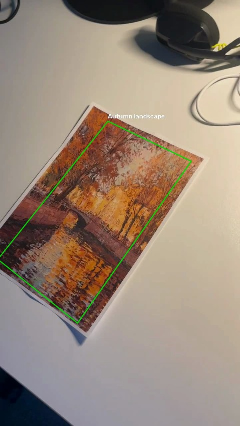 |

[Другие кадры собственного видео](results/own-video-preview.jpg).

Дополнительно `python -m unittest discover -s tests -v` успешно проверяет восстановление четырёхугольника после известного перспективного преобразования и отсутствие ложной рамки на однородном пустом кадре.

## 4. Выводы

Трекинг по ключевым точкам и гомографии позволяет строить повернутую рамку плоского текстурного объекта, терять его при исчезновении и находить после возвращения. Наиболее трудные случаи — сильное размытие, малый размер и недостаток различимых деталей: число надёжных совпадений уменьшается, поэтому часть кадров с видимым объектом пропускается. Точного совпадения с бумажными краями собственного объекта также нет, поскольку они отсутствуют в первом кадре. Для улучшения можно дополнить повторное обнаружение краткосрочным оптическим потоком, сравнить SIFT с другими детекторами на размеченных кадрах и начинать собственное видео с кадра, где видны края листа.

## 5. Использованные источники

1. Задание к ЛР2, предоставленный PDF.
2. [OpenCV: Feature Matching](https://docs.opencv.org/4.10.0/dc/dc3/tutorial_py_matcher.html) — SIFT, BFMatcher и проверка отношения расстояний.
3. [OpenCV: Features2D + Homography to find a known object](https://docs.opencv.org/4.x/d7/dff/tutorial_feature_homography.html) — поиск плоского объекта и перенос углов гомографией.
4. [OpenCV: AKAZE and ORB planar tracking](https://docs.opencv.org/4.12.0/dc/d16/tutorial_akaze_tracking.html) — общая схема трекинга по ключевым точкам.
